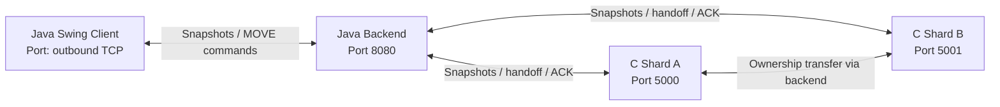

# Distributed Simulation Engine

A real-time distributed simulation built with a **C/POSIX simulation engine**, a **Java TCP orchestration backend**, and a **Java Swing client**.

The project explores spatial sharding, TCP communication, entity ownership transfer, and client-side interpolation across a shard boundary.

> **Project status:** Prototype / portfolio project. The two-shard handoff and client rendering have been exercised locally. Performance, fault recovery, and strict zero-glitch behavior have not yet been benchmarked or formally verified.

## Features

- **C simulation servers** using POSIX TCP sockets.
- **Two spatial shards**:
  - Shard A listens on port `5000` and owns entities in the left region (`x < 500`).
  - Shard B listens on port `5001` and owns entities in the right region (`x >= 500`).
- **Java backend** listening on port `8080`, acting as a TCP proxy between the Swing client and the shard servers.
- **Entity handoff protocol** that forwards migration state and uses an acknowledgement to confirm adoption.
- **Java Swing visualization** displaying entity positions and a selected entity.
- **Client-side interpolation** to smooth movement between received snapshots.
- **Keyboard controls** using WASD or the arrow keys to move the selected entity.

## Architecture



The Java backend accepts a client connection and connects to both C shard servers. It aggregates entity snapshots for the client and routes movement commands to the shard currently recorded as the entity's owner.

When an entity crosses the shard boundary, the source shard sends a migration message through the backend. The destination shard adopts the entity and returns an acknowledgement. The backend then confirms the handoff to the source shard.

## Technology Stack

| Component | Technology | Responsibility |
|---|---|---|
| Simulation engine | C, POSIX sockets | Entity state and simulation ticks |
| Orchestration backend | Java, TCP sockets, threads | Snapshot aggregation, command routing, migration relay |
| Client | Java Swing, AWT | Visualization, keyboard input, interpolation |
| Transport | TCP with newline-delimited JSON messages | Client commands, snapshots, and migration messages |
| Development environment | Linux / Ubuntu, including WSL2 | Build and local execution |

## Requirements

- GCC with C11 support
- Java Development Kit (JDK), including `javac` and `java`
- Linux or Ubuntu; Windows users can use WSL2
- Four terminal sessions for the local multi-process demonstration

## Build

From the project directory:

```bash
gcc -std=c11 -Wall -Wextra -Wpedantic -Werror -O2 server.c -o server -lm
javac Backend.java GameClient.java
```

## Run locally

Start each component in a separate terminal, from the project directory.

**Terminal 1 — Shard A**

```bash
./server 5000
```

**Terminal 2 — Shard B**

```bash
./server 5001
```

**Terminal 3 — Java backend**

```bash
java Backend
```

**Terminal 4 — Swing client**

```bash
java GameClient
```

The backend expects the shard servers to be listening before it connects. The client connects to the backend at `127.0.0.1:8080`.

If a port is already in use, stop the previous process before restarting the relevant component.

## Controls

- **W / Up Arrow:** move the selected entity up
- **S / Down Arrow:** move the selected entity down
- **A / Left Arrow:** move the selected entity left
- **D / Right Arrow:** move the selected entity right

The selected entity is highlighted in cyan/yellow. Other entities are shown in green.

## Protocol overview

Messages are JSON objects terminated by a newline (`\n`) so each TCP stream can be read one message at a time.

Example movement command:

```json
{"type":"move","id":1,"dx":5.0,"dy":0.0}
```

Example migration message:

```json
{"type":"migrate","id":1,"x":500.1,"y":120.0,"vx":0.1,"vy":0.0}
```

Example adoption acknowledgement:

```json
{"type":"ack","id":1}
```

Snapshots contain the current entities owned by a shard. The backend aggregates entity state and publishes a combined snapshot to the client.

**Implementation note:** The current message parsing is intentionally lightweight and based on Java regular expressions / C `sscanf`; it is suitable for this prototype but is not a general-purpose JSON parser.

## Client-side interpolation

The Swing client stores the latest target coordinates received from the backend. On each repaint, it moves the rendered position a fraction of the remaining distance toward the target.

This reduces visible snapping between snapshots. It does not guarantee zero latency or eliminate every visual discontinuity, especially if an entity is temporarily omitted from snapshots, ownership updates race, or network messages are delayed.

## Screenshots and demo

Add your own assets to the repository, for example:

```text
assets/
├── simulation-client.png
└── handoff-demo.gif
```

Then embed them here:

```markdown


[Watch the handoff demo](assets/handoff-demo.gif)
```

Recommended demo (about 30 seconds):

1. Show both C shard terminals and the Java backend.
2. Show the client with the entity count visible.
3. Move the selected entity across `x = 500`.
4. Show the handoff, adoption, and acknowledgement messages.
5. Show that the client continues rendering the entities after the transfer.

Do not claim that a demonstration proves formal consistency or zero-glitch guarantees; describe only what the recording actually shows.

## Known limitations

- The current setup targets a local prototype rather than a production deployment.
- Shard discovery and connection recovery are not implemented as production-grade services.
- Migration and ownership logic should be stress-tested for concurrent commands, stale snapshots, duplicate messages, and failures during handoff.
- The message parser is not a full JSON parser.
- No reproducible throughput, latency, or frame-rate benchmark is included yet.
- Client-side interpolation improves visual continuity but does not itself guarantee distributed-state consistency.
- Authentication, authorization, encryption, deployment automation, and production observability are outside the current prototype scope.

## Possible next steps

- Add integration tests for handoff, duplicate migration messages, and shard disconnection.
- Record migration counts, snapshot rate, command latency, and frame time.
- Introduce structured logging and a proper JSON library.
- Add reconnect/recovery behavior and an explicit ownership protocol.
- Package the application with a single launch script or Docker Compose configuration.

## Repository layout

```text
distributed-simulation-engine/
├── server.c
├── Backend.java
├── GameClient.java
├── README.md
└── assets/
    ├── simulation-client.png
    └── handoff-demo.gif
```

## License

Choose a license before publishing the repository. If you want others to reuse the code, consider adding an appropriate open-source license file.

## Author

**Abdessamad Cherkaoui**

Add your portfolio, GitHub profile, and LinkedIn links here before publishing.

## Phase 5 — Godot 4 and combat prototype

The `phase-5-godot-combat` branch adds `godot/NetworkManager.gd` and extends the C/Java protocol for combat. This branch is a prototype; run and verify it locally before merging.

### Godot scene setup

1. Open Godot 4 and create a project in the repository's `godot/` directory (or create a separate Godot project and copy `NetworkManager.gd` into it).
2. Create a `Node2D` root node and attach `NetworkManager.gd`.
3. Set the project viewport to approximately 1000×650. The script uses world coordinates from the simulation snapshots.
4. Set the exported `player_id` to `1` unless you intentionally change the server's player setup.

The script draws entities as generated colored `Sprite2D` textures: cyan for the player, red for enemies and yellow for projectiles. Use WASD or arrow keys to move, and left-click to shoot toward the mouse pointer.

### Phase 5 protocol

- Snapshot entities now include `id`, `x`, `y`, `type`, `health` and `team`.
- Type `0` is a player, type `1` is an enemy, and type `2` is a projectile.
- A shot command is newline-delimited JSON, for example `{"type":"shoot","player_id":1,"angle":45}`.
- The backend routes a shot to the shard that currently owns its player. It also relays player-state messages to both shards so enemy AI can select the nearest known player across the shard boundary.
- Projectiles move on the server, deal 25 damage on a hit, and are removed after a hit or leaving the world bounds. Enemies have 50 health; a player starts with 100 health.

### Start order

In separate WSL/Ubuntu terminals, from the repository root:

```bash
gcc -std=c11 -Wall -Wextra -Wpedantic -O2 server.c -o server -lm
javac Backend.java
./server 5000
```

Start the second shard with `./server 5001` in another terminal, then run `java Backend` in a third terminal. Launch the Godot scene last so it can connect to `127.0.0.1:8080`. Stop old server processes before restarting them if a port is already occupied.

### Godot threading note

This lightweight client polls the non-blocking `StreamPeerTCP` connection from Godot's main `_process(delta)` loop. That keeps snapshot parsing and Sprite2D changes on the same thread as rendering, which is appropriate for this small prototype. The client does not create a separate network thread.

For higher traffic, move TCP reading and line framing to a background `Thread`, place decoded snapshots in a thread-safe queue protected by a `Mutex`, and consume that queue from `_process(delta)`. The background thread must not add, move or free scene nodes; those scene-tree operations belong on the main thread. This version has not been load-tested and still uses lightweight `sscanf` / regular-expression parsing rather than a complete JSON library.

